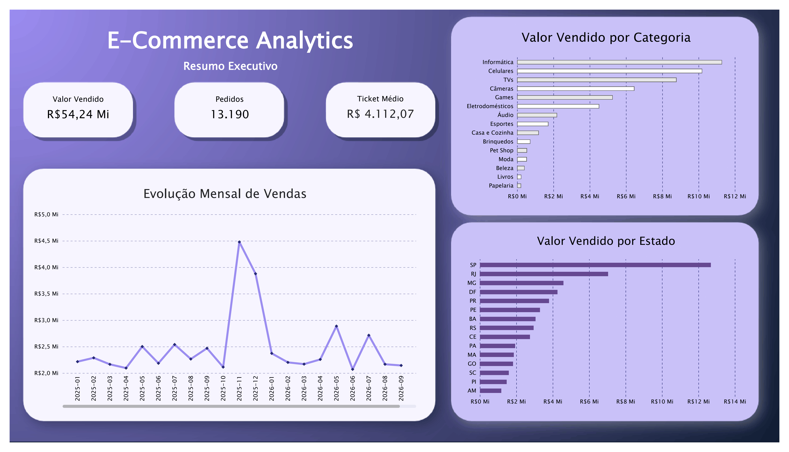
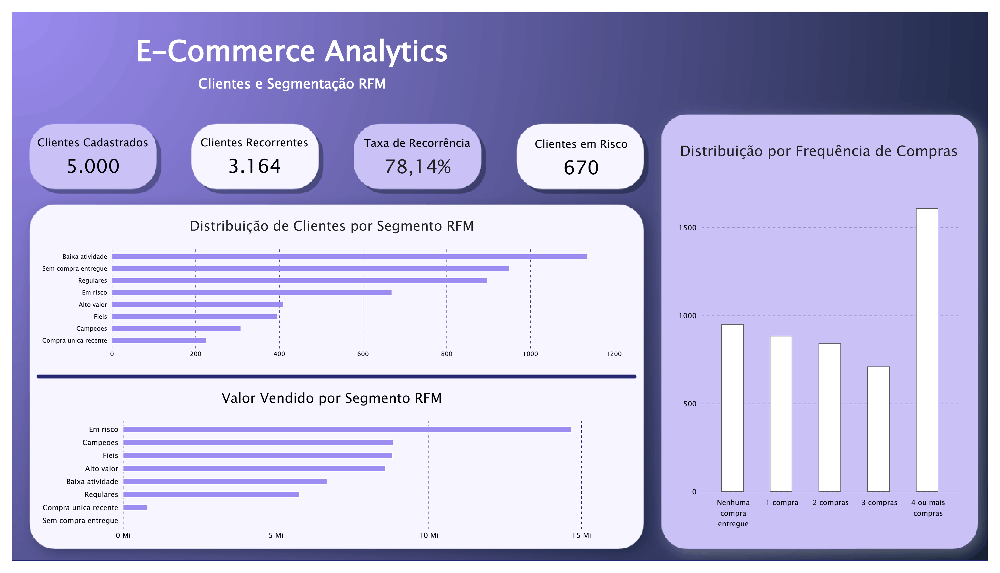
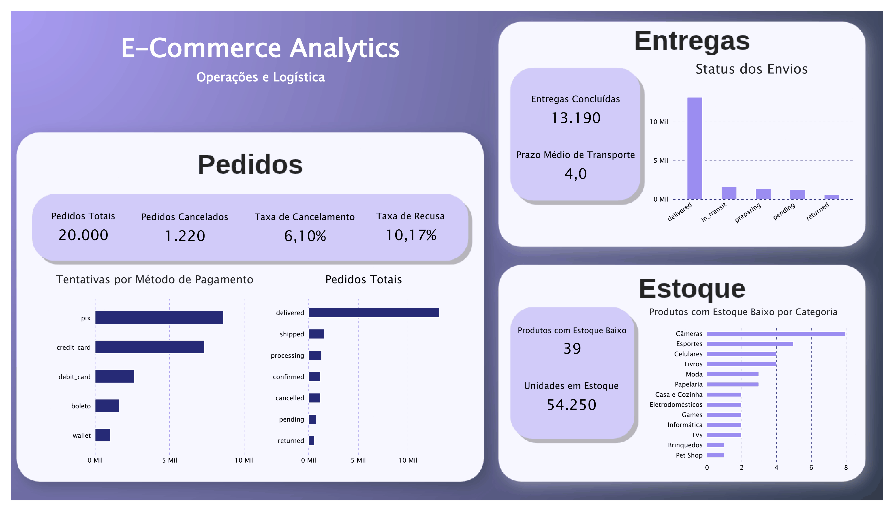
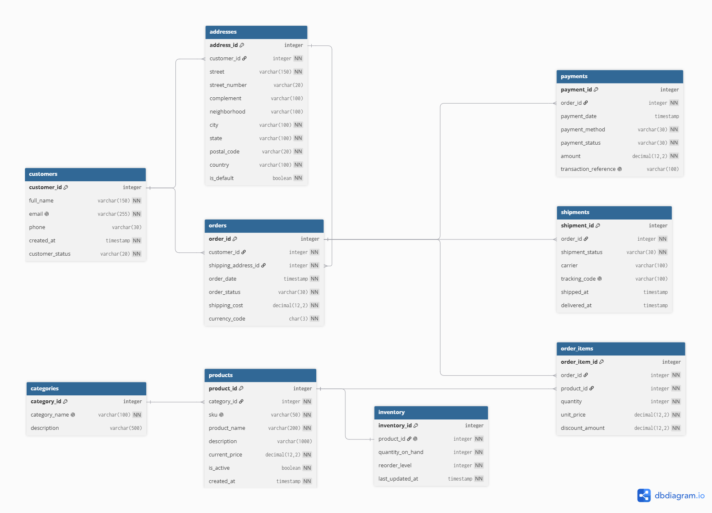

# Análise de E-Commerce | Projeto End-to-End de Dados

**PostgreSQL · Python · SQL · Power BI · Git/GitHub**

Projeto de portfólio que simula o ciclo completo de análise de dados de um e-commerce: **modelagem relacional, geração de dados, carga, qualidade, análise exploratória, segmentação RFM, modelagem dimensional e dashboards em Power BI Desktop**.

> **Projeto fictício:** todos os clientes, pedidos, preços e resultados comerciais são sintéticos. Não representam empresas ou tendências reais do mercado brasileiro.

## Dashboard Power BI — 3 páginas

> **Capturas:** os três arquivos de imagem indicados abaixo serão publicados em `Bi/screenshots/` no último commit. O relatório interativo `.pbix` já está no repositório.

O relatório interativo está disponível para abrir no Power BI Desktop: **[Ecommerce_Analytics.pbix](Bi/Ecommerce_Analytics.pbix)**.

### 1. Resumo Executivo



Vendas de produtos em pedidos entregues, evolução mensal, ticket médio, distribuição por categoria e por estado de entrega.

### 2. Clientes e Segmentação RFM



Quantidade de clientes, recorrência, distribuição de frequência, segmentos de recência/frequência/valor e participação de cada grupo no valor vendido.

**A classificação RFM é um retrato histórico com data de referência fixa em 17/11/2026**; não é um modelo preditivo de abandono.

### 3. Operações e Logística



Status dos pedidos, taxas de cancelamento e de recusa de tentativas de pagamento, meios de pagamento, envios, prazo de transporte e situação do estoque.

## Dataset e indicadores principais

| Indicador | Resultado |
| --- | ---: |
| Clientes cadastrados | **5.000** |
| Produtos e categorias | **500 produtos / 15 categorias** |
| Pedidos totais | **20.000** |
| Pedidos entregues | **13.190** |
| Itens de pedido | **43.941** |
| Registros nas 9 tabelas operacionais | **114.821** |
| Valor vendido dos produtos de pedidos entregues | **R$ 54.238.147,33** |
| Ticket médio desses pedidos | **R$ 4.112,07** |
| Clientes recorrentes (2 ou mais pedidos entregues) | **3.164 de 4.049 compradores (78,14%)** |
| Clientes classificados como "Em risco" pelo RFM | **670** |
| Produtos com estoque baixo | **39** |
| Unidades em estoque | **54.250** |
| Validações iniciais de qualidade | **8 regras sem inconsistências encontradas** |

**Período sintético dos pedidos:** janeiro de 2025 a outubro de 2026.

**Definição de valor vendido:** soma do valor dos produtos nos pedidos com status `delivered`, usando preços históricos após descontos, **sem frete**. Não equivale ao faturamento contábil nem aos recebimentos de caixa. A taxa de recusa de pagamentos é calculada por **tentativas**, não por pedidos.

## Descobertas da análise exploratória

- **Sazonalidade:** novembro de 2025 teve o maior valor vendido daquele ano (cerca de R$ 4,48 milhões), refletindo a sazonalidade simulada no gerador.
- **Categorias:** Informática, Celulares e TVs lideraram em valor vendido.
- **Geografia:** São Paulo apresentou o maior valor vendido (aproximadamente R$ 12,67 milhões). A distribuição geográfica foi definida no dataset sintético.
- **Clientes:** os 1.610 clientes com quatro ou mais pedidos entregues concentraram **64,48%** do valor histórico vendido de produtos.
- **RFM:** os 670 clientes do segmento *Em risco* representam **27,07%** do valor histórico vendido, mas isso é uma classificação por regras e **não comprova risco real de evasão**.

[Metodologia e resultados detalhados](docs/analise_exploratoria.md) · [Estudo de caso exploratório opcional](docs/estudo_de_caso_clientes.md)

## Arquitetura da solução

**Pipeline:** modelagem SQL → geração sintética em Python → arquivos CSV locais → PostgreSQL → checagens de integridade → views analíticas no schema `bi` → Power BI Desktop.



O modelo operacional tem nove tabelas: `customers`, `addresses`, `categories`, `products`, `orders`, `order_items`, `payments`, `shipments` e `inventory`.

A camada para BI contém dimensões de clientes, produtos, datas e estados; duas tabelas de fatos comerciais e três fatos adicionais de pagamentos, envios e estoque. No Power BI, os filtros seguem as dimensões, respeitando a granularidade de cada fato. O retrato de estoque não é uma série temporal.

## Como reproduzir

**Pré-requisitos:** PostgreSQL, Python 3.10+ e Power BI Desktop (gratuito para criação local). Os comandos partem da raiz do repositório, no Windows.

1. Crie um banco vazio chamado `ecommerce` no PostgreSQL e, conectado a ele, execute [`Sql/01_create_tables.sql`](Sql/01_create_tables.sql).
2. Gere os nove arquivos CSV sintéticos com semente reproduzível:

   ```powershell
   py Python/02_generate_data.py
   ```

3. Instale o driver e importe os CSVs:

   ```powershell
   py -m pip install "psycopg[binary]"
   py Python/03_import_data.py
   ```

   O importador pede a senha do PostgreSQL e a confirmação da carga. Ele exige as tabelas vazias e desfaz a transação em caso de erro.

4. Execute as validações em [`Sql/02_data_quality_checks.sql`](Sql/02_data_quality_checks.sql).
5. Crie as views analíticas, nesta ordem:
   - [`Sql/12_create_bi_views.sql`](Sql/12_create_bi_views.sql)
   - [`Sql/13_extend_bi_customer_operations.sql`](Sql/13_extend_bi_customer_operations.sql)
6. Abra [`Bi/Ecommerce_Analytics.pbix`](Bi/Ecommerce_Analytics.pbix) no Power BI Desktop. O arquivo pode exigir atualização da conexão `localhost:5432` com o banco `ecommerce` e suas **credenciais locais**. O Power BI Desktop não é o PostgreSQL; o banco precisa estar disponível quando uma atualização for solicitada.

Os CSVs são gerados em `data/generated/` e ignorados pelo Git para evitar versionar arquivos recriáveis. **Nenhuma senha é necessária no repositório.**

## Estrutura do repositório

```text
.
├── Bi/
│   ├── Ecommerce_Analytics.pbix
│   ├── screenshots/                   # Capturas das três páginas
│   ├── README.md
│   └── GUIA_PAGINAS_2_3.md
├── Diagram/
│   └── diagrams_01_operational_model.png
├── Python/
│   ├── 02_generate_data.py
│   ├── 03_import_data.py
│   └── README.md
├── Sql/
│   ├── 01_create_tables.sql
│   ├── 02_data_quality_checks.sql
│   ├── 03_eda_sales.sql ... 07_eda_rfm_basics.sql
│   ├── 11_customer_rfm_segments.sql
│   ├── 12_create_bi_views.sql
│   ├── 13_extend_bi_customer_operations.sql
│   ├── estudos_de_caso/
│   └── README.md
├── docs/
│   ├── analise_exploratoria.md
│   └── estudo_de_caso_clientes.md
└── README.md
```

## Entregas e habilidades demonstradas

- **Modelagem de dados:** diagrama relacional e esquema dimensional para BI.
- **Python:** geração determinística de dados de teste e carga transacional em PostgreSQL.
- **SQL:** relacionamentos, CTEs, agregações, auditoria, análises comerciais, RFM e views.
- **Power BI / DAX:** relacionamentos, medidas, KPIs, gráficos e apresentação de resultados em três páginas.
- **Engenharia e documentação:** boas práticas de Git, histórico de versionamento, scripts reproduzíveis e documentação técnica.

**Limitações:** o projeto utiliza um cenário simulado e dados sintéticos. As regras de sazonalidade, geografia, preços e recorrência foram definidas no gerador; o RFM é descritivo e a posição de estoque é um retrato. As análises não permitem inferir tendências de consumo reais, rentabilidade ou causalidade.

[Guia de SQL](Sql/README.md) · [Pipeline Python](Python/README.md) · [Guia Power BI](Bi/README.md)
