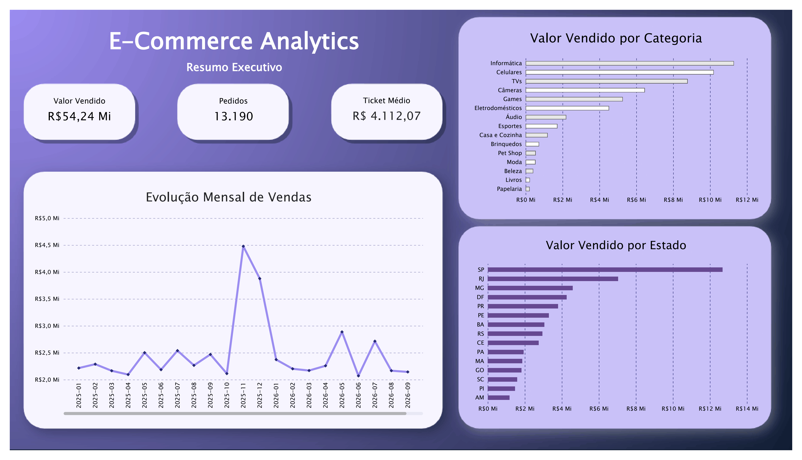
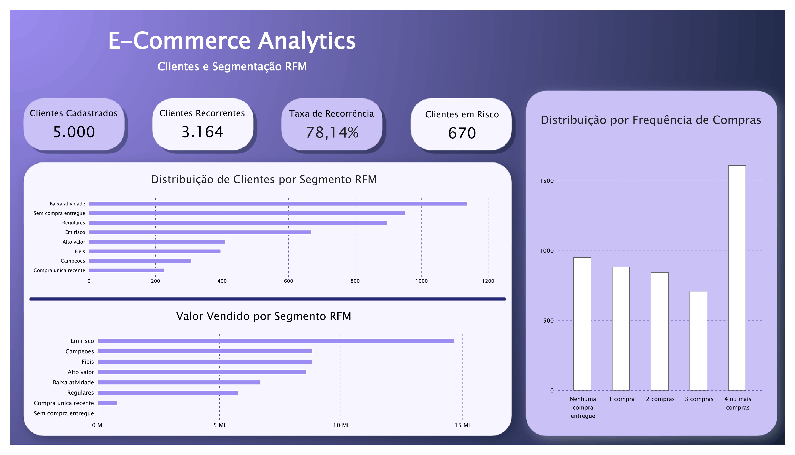
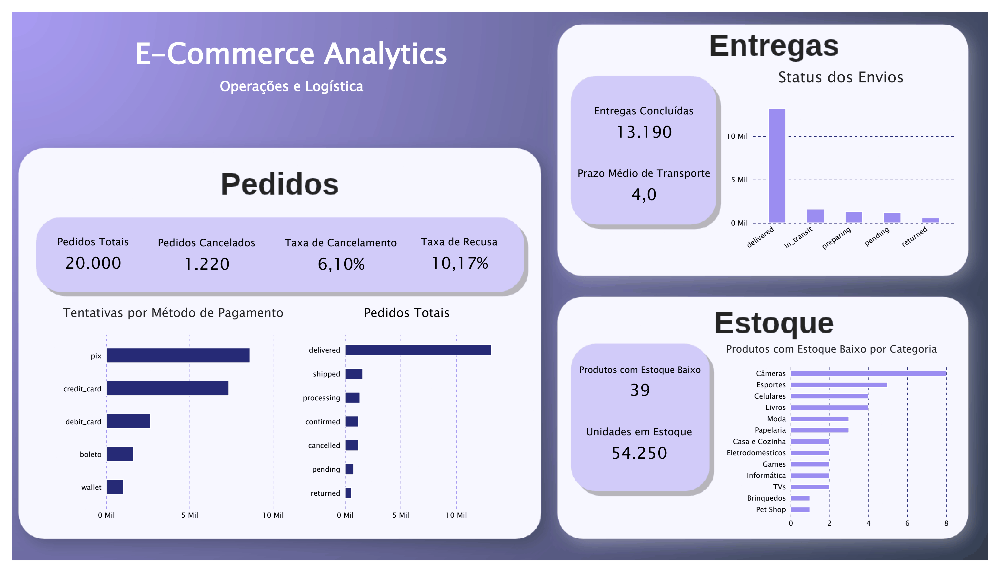
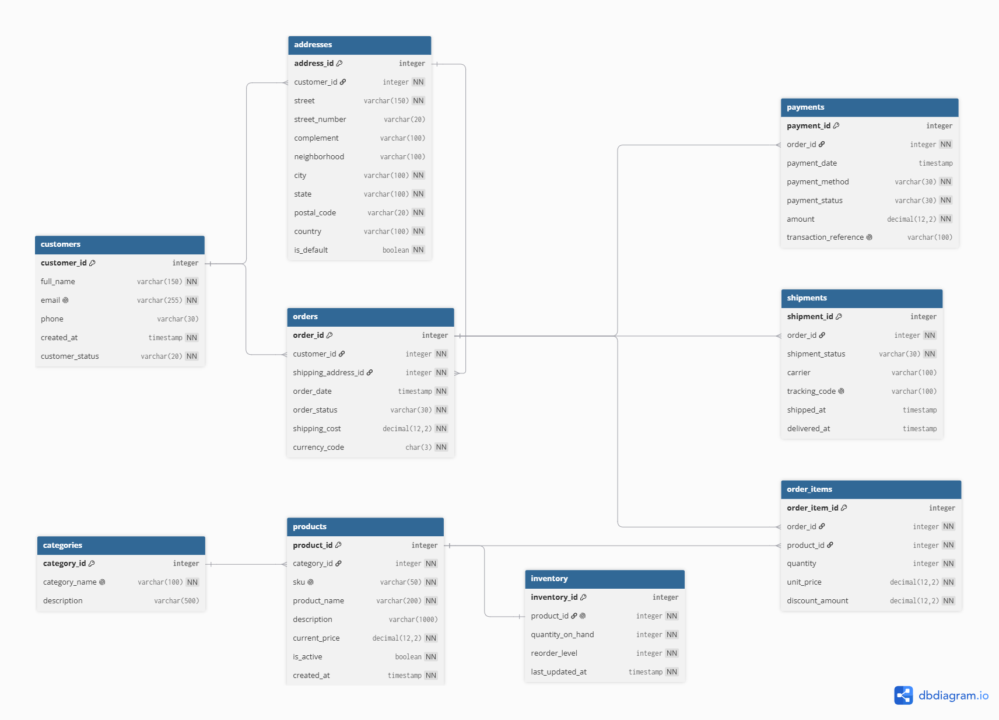

# E-Commerce Analytics | End-to-End Data Project

🇺🇸 **English** | 🇧🇷 [Português](README.md)

**PostgreSQL · Python · SQL · Power BI · Git/GitHub**

A portfolio project simulating the full analytics lifecycle of an e-commerce business: **relational data modeling, synthetic data generation, data loading, quality checks, exploratory analysis, RFM segmentation, dimensional modeling, and interactive dashboards in Power BI Desktop**.

> **Fictional project:** all customers, orders, prices, and business results are synthetic. They do not represent actual companies or real-world trends in Brazilian retail.

## Power BI Dashboard — 3 Pages

The interactive report can be opened in Power BI Desktop: **[Ecommerce_Analytics.pbix](Bi/Ecommerce_Analytics.pbix)**. Screenshots of all three pages are included below.

### 1. Executive Overview



Product sales value from delivered orders, monthly trends, average order value, performance by product category, and geographic distribution by shipping state.

### 2. Customers & RFM Segmentation



Customer counts, repeat purchasing, purchase frequency, Recency–Frequency–Monetary (RFM) segments, and each segment's contribution to historical product sales value.

**RFM segmentation is a historical snapshot as of November 17, 2026**. It is a rule-based descriptive classification, not a predictive churn model.

### 3. Operations & Logistics



Order statuses, cancellation and declined-payment-attempt rates, payment methods, shipments, transportation time, and current inventory levels.

*The dashboard itself is in Portuguese. This English README provides an overview for international reviewers.*

## Dataset & Key Metrics

| Metric | Result |
| --- | ---: |
| Registered customers | **5,000** |
| Products and categories | **500 products / 15 categories** |
| Total orders | **20,000** |
| Delivered orders | **13,190** |
| Order line items | **43,941** |
| Records across 9 operational tables | **114,821** |
| Product sales value from delivered orders | **BRL 54,238,147.33** |
| Average product value per delivered order | **BRL 4,112.07** |
| Repeat customers (2+ delivered orders) | **3,164 of 4,049 buyers (78.14%)** |
| Customers classified as "At Risk" by RFM | **670** |
| Products at or below reorder level | **39** |
| Units on hand | **54,250** |
| Initial data-quality checks | **8 rules passed with no issues detected** |

**Synthetic order period:** January 2025 to October 2026.

**Product sales value definition:** the sum of line-item values in orders with status `delivered`, using historical unit prices less discounts and **excluding shipping charges**. This is **not** recognized accounting revenue or cash received. The payment-decline rate is calculated per **payment attempt**, not per order.

## Key Findings from Exploratory Analysis

- **Seasonality:** November 2025 had the highest product sales value within that year (approximately **BRL 4.48 million**), reflecting seasonality deliberately built into the generator.
- **Categories:** Computers/IT (*Informática*), Mobile Phones (*Celulares*), and TVs ranked highest by product sales value.
- **Geography:** São Paulo recorded the highest product sales value (approximately **BRL 12.67 million**). Geographic weights were defined in the synthetic dataset.
- **Customers:** **1,610** customers with at least four delivered orders accounted for **64.48%** of historical product sales value.
- **RFM:** the **670** customers in the *At Risk* (*Em risco*) segment accounted for **27.07%** of historical product sales value. This is a rule-based grouping and **does not establish actual churn risk**.

Additional documentation (in Portuguese): [Detailed analysis and methodology](docs/analise_exploratoria.md) · [Optional exploratory case study](docs/estudo_de_caso_clientes.md).

## Solution Architecture

**Pipeline:** SQL data modeling → synthetic dataset generation in Python → local CSV files → PostgreSQL → integrity and quality checks → analytical views in the `bi` schema → Power BI Desktop.



The operational model contains nine tables: `customers`, `addresses`, `categories`, `products`, `orders`, `order_items`, `payments`, `shipments`, and `inventory`.

The BI layer includes customer, product, date, and state dimensions; two sales fact tables; and three additional fact tables for payment attempts, shipments, and inventory. Power BI relationships use shared dimensions while preserving each fact table's grain. Inventory is a current snapshot, **not** a time series.

## How to Reproduce

**Requirements:** PostgreSQL, Python 3.10+, and Power BI Desktop (free for local report development). The commands below assume Windows and are run from the repository root.

1. Create an empty PostgreSQL database named `ecommerce`. Connect to it and run [`Sql/01_create_tables.sql`](Sql/01_create_tables.sql).
2. Generate the nine synthetic CSV files using the reproducible default random seed:

   ```powershell
   py Python/02_generate_data.py
   ```

3. Install the PostgreSQL Python driver and import the CSVs:

   ```powershell
   py -m pip install "psycopg[binary]"
   py Python/03_import_data.py
   ```

   The importer prompts for the PostgreSQL password and requires confirmation before loading. It checks that all nine tables are empty and rolls back the transaction if an error occurs.

4. Run the quality checks in [`Sql/02_data_quality_checks.sql`](Sql/02_data_quality_checks.sql).
5. Create the analytical views **in this order**:
   - [`Sql/12_create_bi_views.sql`](Sql/12_create_bi_views.sql)
   - [`Sql/13_extend_bi_customer_operations.sql`](Sql/13_extend_bi_customer_operations.sql)
6. Open [`Bi/Ecommerce_Analytics.pbix`](Bi/Ecommerce_Analytics.pbix) in Power BI Desktop. Data refresh may require setting up the `localhost:5432` connection to the `ecommerce` database using **your own local credentials**. PostgreSQL must be available when refreshing the report.

Generated CSVs are stored locally in `data/generated/` and excluded from Git because they can be regenerated. **Never add database passwords or credentials to the repository.**

## Repository Structure

```text
.
├── Bi/
│   ├── Ecommerce_Analytics.pbix
│   ├── screenshots/                  # Three dashboard screenshots
│   └── README.md
├── Diagram/
│   └── diagrams_01_operational_model.png
├── Python/
│   ├── 02_generate_data.py
│   ├── 03_import_data.py
│   └── README.md
├── Sql/
│   ├── 01_create_tables.sql
│   ├── 02_data_quality_checks.sql
│   ├── 03_eda_sales.sql ... 07_eda_rfm_basics.sql
│   ├── 11_customer_rfm_segments.sql
│   ├── 12_create_bi_views.sql
│   ├── 13_extend_bi_customer_operations.sql
│   ├── estudos_de_caso/
│   └── README.md
├── docs/
│   ├── analise_exploratoria.md
│   └── estudo_de_caso_clientes.md
├── README.md
└── README_EN.md
```

## Deliverables & Skills Demonstrated

- **Data modeling:** relational entity-relationship diagram and dimensional/star schema for BI.
- **Python:** deterministic test data generation and transactional PostgreSQL loading.
- **SQL:** joins, CTEs, aggregations, audits, sales analyses, RFM, and analytical views.
- **Power BI / DAX:** relationships, measures, KPIs, interactive charts, and three dashboard pages.
- **Version control & documentation:** Git history, reproducible scripts, technical documentation, and a navigable project structure.

**Limitations:** the business scenario and data are fully synthetic. Seasonal patterns, geographic weights, pricing, and purchasing behavior are defined by the generator; RFM segments are descriptive, and inventory shows a snapshot. The findings **cannot** be used to infer real-world consumer trends, profitability, or causality.

Technical documentation (in Portuguese): [SQL Guide](Sql/README.md) · [Python Pipeline](Python/README.md) · [Power BI Guide](Bi/README.md).
